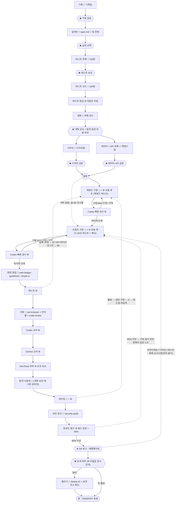

# build-app 그래프 — 노드(업무) · 엣지(통과/실패 길) · 상태(state.json)

앱 작업은 이 흐름을 **자동으로** 따른다. 순서는 `graph.sh`가 이 파일의 표만 읽고 지킨다(표에 없는 엣지는 거부).
상태는 `apps/<앱>/state.json`(graph.sh만 씀, 커밋 대상). 노드 **안** 회차 기록은 `docs/progress.md`.

- **사장은 명령을 치지 않는다. ★에서 보기만 누른다. 질문은 구현 전에만**(기획·설계·테스트 목록·계획·디자인·데이터) + ok-qa·pub.
- 노드 안의 고치기는 자동 루프(횟수 제한), 노드 사이 이동은 이 그래프가 정한다. 문제가 생기면 처음부터가 아니라 **문제를 만든 담당 노드에만** 돌려보낸다.
- 단순한 검사(테스트 통과, 비밀값, 잠금 해시, `.redteam-needed`, 성능 수치, 점수)는 AI가 판단하지 않고 프로그램(⚙️)이 한다.

담당: 🤖 AI(팀·에이전트) · ⚙️ 프로그램(graph.sh·훅·테스트) · 🌐 외부 AI · ★ 사람(보기 클릭)


점선 = 실패 엣지 대표. 정답은 아래 "실패 엣지 표".

## 멈추는 곳은 다섯 가지뿐
| # | 언제 | 상태(state.json) | 하는 일 |
|---|---|---|---|
| ① | ★ 노드(구현 전 질문, ok-qa, pub) | 사장 대기 | AskUserQuestion으로 보기 + 추천 → 답을 `approve` |
| ② | 되돌아온 횟수 초과, 자동 루프 15회·같은 실패 3연속, 점수 5바퀴·2바퀴 정체, 같은 상태로 3번 멈춤 | 사장 보고 | 무엇이·왜 막혔는지 + 보기 2~3개 + 추천 |
| ③ | 필요한 도구가 없음(Codex·Gemini 미설치 등) | 도구 없음 | 설치 방법 안내(대신하거나 건너뛰지 않음) |
| ④ | 탐색·사용성 실제 사용량이 알린 예상의 2배 초과 | 사장 대기 | 계속할지 묻기 |
| ⑤ | 안전장치가 막은 외부 공개, 승인된 테스트 다시 잠그기 | 사장 대기 | 붙여 넣을 한 줄을 코드 블록으로 보여 주고 기다림 |

이 밖에는 묻지도 멈추지도 않는다("다음 단계 진행할까요?" 금지). **구현 시작(bb 또는 bf)부터 ok-qa까지는 질문·보고 없음.**
그 구간에서 표에 없는 실패, '높음'인데 애매한 지적, 요구사항·테스트 목록을 바꿔야 할 것 같은 지적은 고치지 않고 `docs/ask-later.md`에 근거와 추천을 적어 두었다가 ok-qa 보고에 "사장 확인 필요"로 올린다. 그것 때문에 진행이 막히면 ②.
재잠금 안내 줄(⑤): <!-- relock: ! bash .claude/hooks/approve-tests.sh apps/<앱> -->`! bash .claude/hooks/approve-tests.sh apps/<앱>`

## 노드 표
- 종류: AI / 프로그램 / 외부AI / 사람(★) / AI+프로그램 / 끝. 검사: graph.sh가 직접 돌리는 ⚙️ 검사(`-`면 AI가 통과 조건을 확인하고 `pass`).
- 다음: `a+b` = 동시에 둘 다, `a,b` = 하나를 고름(`pass … <다음>`). 다시: 고치러 되돌아온 뒤(resume 있음) 통과하면 가는 곳. 합류: 이 노드들이 모두 통과·건너뜀일 때만 시작.
- 최대: 다른 AI·프로그램 노드에서 보낸 실패로 **이 노드에 되돌아온** 횟수 한도(넘으면 ②). ★에서 보낸 수정 지시는 세지 않는다(★ 수정 지시는 횟수 제한 없음).
- 옛 단계: 그래프 이전 HANDOFF "현재 단계: N"과의 대응(`graph.sh migrate`).

<!-- nodes:start -->
| id | 이름 | 종류 | 담당 | 받는 것 | 내는 것 | 통과 조건 | 검사 | 다음 | 다시 | 합류 | 실패 시 | 최대 | 건너뛰기 | 옛 단계 |
|---|---|---|---|---|---|---|---|---|---|---|---|---|---|---|
| req | 기획 | AI | 기획팀(agent-reach·ecc:market-research·superpowers:brainstorming) | 사장 답(★ 질문) | docs/requirements.md | 기획서 + "꼭 되어야 할 기능" 목록(F1, F2 …) | - | ok-req | - | - | - | 2 | - | 1 |
| ok-req | ★기획 검토 | 사람 | 사장 | docs/requirements.md | 승인 기록 | approve | - | opt | - | - | req | - | - | 1 |
| opt | 설계안 | AI | 팀 전체(superpowers:brainstorming·awesome-design) | docs/requirements.md | docs/spec.md, docs/design.md | 설계안 3개 + 점수표 + 디자인 방향 + 추천 | - | ok-opt | - | - | - | 3 | - | 2 |
| ok-opt | ★설계 선택 | 사람 | 사장 | docs/design.md | 승인 기록 | approve | - | tl | - | - | opt | - | - | 2 |
| tl | 테스트 목록 | AI | QA팀 | docs/spec.md | docs/tests.md | 쉬운 말 목록 + 기능(F번호) ↔ 테스트 대응 | - | ok-tl | - | - | - | 2 | - | 3 |
| ok-tl | ★테스트 승인 | 사람 | 사장 | docs/tests.md | 승인 기록 | approve | - | tc | - | - | tl | - | - | 3 |
| tc | 테스트 코드 | AI | QA팀(ecc:e2e-testing·ecc:react-testing) | docs/tests.md | tests/, HANDOFF 테스트 실행 줄 | 테스트 파일 + 실행 줄 | - | lock | - | - | - | 3 | - | 3 |
| lock | 테스트 잠금 | 프로그램 | auto-lock.sh(처음), 사장(다시 잠글 때 ⑤) | tests/ | tests/.approved | 잠금 파일 있음 + 해시 일치 | lock | ip | bf | - | - | - | - | 3 |
| ip | 계획 | AI | 계획 모드(superpowers:writing-plans, 이어 하는 앱은 modern-web-guidance 점검) | spec·design·tests.md | docs/plan.md | 단계별 확인 방법 + 탐색 점검 예상 비용 | - | ok-ip | - | - | - | 3 | - | 4 |
| ok-ip | ★계획 승인 | 사람 | 사장 | docs/plan.md | 승인 기록 + 탐색 점검 여부(budget) | approve + budget | - | ui+dd | - | - | ip | - | - | 4 |
| ui | 디자인 | AI | 디자인팀 서브에이전트(hallmark·frontend-design) | docs/spec.md | docs/DESIGN.md, docs/mockups/ | DESIGN.md + 시안 캡처 | - | ok-ui | bf | - | - | 3 | 화면 없음 | 4 |
| dd | 데이터·API | AI | 백엔드팀 서브에이전트 | docs/spec.md | docs/data.md, docs/api.md | 저장할 데이터(쉬운 말) + API 예시(아래 형식) | - | ok-dd | - | - | - | 3 | 서버 없음 | 4 |
| ok-ui | ★디자인 검토 | 사람 | 사장 | DESIGN.md, 시안 캡처 | 승인 기록 | approve | - | bb | - | - | ui | - | 화면 없음 | 4 |
| ok-dd | ★데이터·API 검토 | 사람 | 사장 | data.md, api.md | 승인 기록 | approve | - | bb | - | - | dd | - | 서버 없음 | 4 |
| bb | 백엔드 구현 | AI+프로그램 | 백엔드팀 + 자동 루프(ecc:springboot-*) | plan.md, api.md | 서버 코드, JUnit, tests/backend.sh, docs/progress.md | 백엔드 테스트 줄 통과 | backend | cb | tr | ok-ui,ok-dd | - | 5 | 서버 없음 | 4 |
| cb | Codex 빠른 검수(백엔드) | 외부AI | Codex(cross-review.sh) | 그 plan 단계 변경분 | docs/review_codex.md | 맞는 지적 없음(1라운드) | - | bb,bf | - | - | bb | - | 서버 없음 | 4 |
| bf | 프론트 구현 | AI+프로그램 | 프론트팀 + 자동 루프(modern-web-guidance·context7·ponytail) | plan.md, api.md, DESIGN.md | 화면 코드, docs/progress.md | 테스트 실행 줄 통과 + 개수(통과 ≥ 승인·건너뜀 0) + 해시 일치 | tests | cf | tr | ok-ui,ok-dd | - | 5 | - | 4 |
| cf | Codex 빠른 검수(프론트) | 외부AI | Codex(cross-review.sh) | 그 plan 단계 변경분 | docs/review_codex.md | 맞는 지적 없음(1라운드) | - | bf,ug | - | - | bf | - | - | 4 |
| ug | 화면 점검 | AI | web-design-guidelines, break-ui | 실행 중인 앱(localhost) | docs/ui-check.md | 맞는 지적 해결(근거 줄) | - | tr | - | - | bf,ui | 3 | 화면 없음 | 5 |
| tr | 테스트 | 프로그램 | graph.sh | 테스트 실행 줄 | docs/test-log.txt | 전체 통과 + 개수(통과 ≥ 승인·건너뜀 0) + 해시 일치 | tests | qa | - | - | bf,bb | - | - | 5 |
| qa | 리뷰 | AI | qa-reviewer + ecc:react-reviewer·ecc:java-reviewer + code-review | 앱 폴더, docs/tests.md | docs/review.md | 맞는 지적 해결(1라운드) + 바뀐 준비 코드 리뷰(아래) | - | cx | - | - | bf,bb,ui | 3 | - | 5 |
| cx | Codex 교차 검수 | 외부AI | Codex(cross-review.sh) | 리뷰 기준~지금 | docs/review_codex.md | 맞는 지적 해결(1라운드) | - | gm | - | - | bf,bb,ui | 3 | - | 5 |
| gm | Gemini 교차 검수 | 외부AI | Gemini(cross-review.sh) | 리뷰 기준~지금 | docs/review_result.md | 맞는 지적 해결(1라운드) | - | dv | - | - | bf,bb,ui | 3 | - | 5 |
| dv | DevTools·부하 점검 | 프로그램 | graph.sh(측정은 chrome-devtools MCP·부하 도구) | 실행 중인 앱(localhost) | docs/perf.txt | 수치 기준(아래) | perf | ex | - | - | bf,bb | 3 | 화면·서버 둘 다 없음 | 6 |
| ex | 탐색·사용성 | AI | Claude 브라우저(localhost) | 주요 흐름 | docs/explore.md | 찾은 버그 해결 | - | rt | - | - | bf,bb | 3 | 사장이 건너뛰기 고름 | 6 |
| rt | 레드팀 | AI+프로그램 | red-team 에이전트 | 실행 중인 앱 | docs/redteam.md | 심각 뚫림 해결 + .redteam-needed 없음 | redteam | sa | - | - | bb,bf | 3 | - | 6 |
| sa | 보안 감사 | AI | security-audit | 저장소 | docs/security-audit.md | 확인된 문제 해결 | - | sc | - | - | bb,bf | 3 | - | 6 |
| sc | 완성도 점수 | 프로그램 | graph.sh score | checklist·리뷰·perf·tests | state.json score | 필수 관문 + 90% 이상 | score | ok-qa | - | - | bb,bf,ui,rt | 5 | - | 6 |
| ok-qa | ★QA 보고·해결됐어요 | 사람 | 사장 | QA 보고(점수·항목별 ✓/✗·남은 것·사장 확인 필요) | 승인 기록 | approve(해결됐어요) | - | pub | - | - | bf,bb,ui,tl,req | - | - | 6 |
| pub | ★공개 여부 | 사람 | 사장 | 비밀값 검사 결과 | HANDOFF 기록 | approve + 비밀값 0 | secrets | dep,done | - | - | - | - | - | 6 |
| dep | 올리기 | AI | Claude(apps/<앱>/deploy.sh) | 앱 파일 | 공개 주소 | 공개 주소에서 새 버전·핵심 기능 확인 | - | done | - | - | bf | 3 | 사장이 안 올림 고름 | 6 |
| done | 끝 | 끝 | - | - | - | - | - | - | - | - | - | - | - | 6 |
<!-- nodes:end -->

## 실패 엣지 표
- 고친 뒤: `@self` = 고친 다음 tr을 거쳐 **보낸 노드로 다시**(레드팀 재공격·점수 다시·"해결됐어요?" 다시), `@next` = tr을 거쳐 **보낸 노드의 다음 노드로**(리뷰는 1라운드), `@normal` = 고친 노드의 정상 길대로.
- 이미 고치는 중(resume 있음)에 다른 실패가 나면 처음 정한 돌아갈 곳을 그대로 둔다.
- 보낼 곳이 여럿이면(`fail … bb,bf`) **bb 먼저, 끝나면 bf**(같은 폴더에서 동시에 고치지 않음).

<!-- fails:start -->
| 출발 | 실패 종류 | 보낼 곳 | 고친 뒤 | 먼저 묻기 |
|---|---|---|---|---|
| ok-req | 사장 수정 지시 | req | @normal | - |
| ok-opt | 사장 수정 지시 | opt | @normal | - |
| ok-tl | 사장 수정 지시 | tl | @normal | - |
| ok-ip | 사장 수정 지시 | ip | @normal | - |
| ok-ui | 사장 수정 지시 | ui | @normal | - |
| ok-dd | 사장 수정 지시 | dd | @normal | - |
| cb | Codex 지적 | bb | @normal | - |
| cf | Codex 지적 | bf | @normal | - |
| ug | 화면 문제 | bf | @next | - |
| ug | 디자인 규칙 위반 | ui | @next | - |
| tr | 테스트 실패(화면 → bf / API·데이터·로그인 → bb) | bf,bb | @self | - |
| qa,cx,gm | 맞는 지적(화면 → bf / API·데이터·로그인 → bb) | bf,bb | @next | - |
| qa,cx,gm | 디자인 규칙 위반 | ui | @next | - |
| dv | 수치 미달(화면 → bf / 서버 → bb) | bf,bb | @self | - |
| ex | 버그 | bf,bb | @next | - |
| rt | 뚫림 | bb,bf | @self | - |
| sa | 확인된 문제 | bb,bf | @next | - |
| sc | 점수 미달·필수 관문 실패(graph.sh가 자동으로 고름) | bb,bf,ui,rt | @self | - |
| ok-qa | 아직이에요(화면 → bf / API·데이터·로그인 → bb) | bf,bb | @self | - |
| ok-qa | 디자인 규칙 위반 | ui | @self | - |
| ok-qa | 테스트 목록에 없는 요구 | tl | @self | 사장 |
| ok-qa | 요구사항 자체가 틀림 | req | @normal | 사장 |
| dep | 올린 주소에서 안 됨 | bf | @self | - |
<!-- fails:end -->
표에 없는 실패 → 구현 전이면 ① 보기 + 추천으로 묻기, 구현~QA 보고 사이면 `docs/ask-later.md`(위 "멈추는 곳").

## 배포 전 체크리스트 20개 → 채우는 노드 (빠지는 항목 0)
결과는 `docs/checklist.md`에 `| 번호 | ✓ 또는 ✗ 또는 해당 없음 | 근거: <앱 폴더 기준 파일>:<줄> |` 한 줄씩. sc가 읽어 점수에 넣고 ok-qa 보고에 그대로. "담당"은 ✗일 때 sc가 보내는 노드(`-`는 사장 확인이 필요해 자동으로 못 고침).

<!-- checklist:start -->
| # | 항목 | 채우는 노드 | 담당 |
|---|---|---|---|
| 1 | 배포된 사이트·앱에서 sk-·secret·service_role 검색 0 | pub⚙️, sc 관문, sa | bb |
| 2 | 한 번이라도 노출된 키는 재발급 | rt·sa → ok-qa | - |
| 3 | 가격·할인·배송비는 서버가 계산 | qa, rt | bb |
| 4 | ID만 바꿔 남의 데이터를 못 봄 | rt | bb |
| 5 | 관리자 화면은 서버 권한 확인 뒤에만 | qa, rt | bb |
| 6 | 브라우저에서 DB 직접 못 붙음 | rt | bb |
| 7 | 민감정보 암호화 저장 | dd, qa, sa | bb |
| 8 | AI 기능 사용자별 사용 한도 | qa, rt | bb |
| 9 | 레드팀 돌리고 나온 문제 고침 | rt | rt |
| 10 | 요청 횟수 제한, 바꾼·만료 토큰 거부 | rt | bb |
| 11 | 쿠폰·결제 등 동시 20번 → 한 번만 처리 | rt | bb |
| 12 | .redteam-needed 표시 없음 | rt⚙️, sc 관문 | rt |
| 13 | 결제는 PG사 재조회 뒤 주문 확정 | qa, rt | bb |
| 14 | 가입 동의 필수·선택 분리 | tl → tr⚙️ | bf |
| 15 | 하단 개인정보처리방침·약관·사업자 정보 | tl → tr⚙️, ug | bf |
| 16 | 연습용·운영 DB 분리 + 매일 백업 | dd, sa | bb |
| 17 | Chrome·webkit·폰 크기에서 승인 테스트 통과 | tc → tr⚙️ | bf |
| 18 | axe 심각한 위반 0 | tc → tr⚙️, ug | bf |
| 19 | LCP 2.5초·CLS 0.1 이하, 콘솔 에러 0 | dv⚙️ | bf |
| 20 | 동시 50명 부하 에러 0%·응답 99% 1초 이하 | dv⚙️ | bb |
<!-- checklist:end -->

## pass 할 때 graph.sh가 더 보는 것
**다음 노드**: `pass <노드> <다음>`의 `<다음>`은 노드 표 '다음' 칸에 있어야 한다. 없으면(없는 노드, 다른 노드의 다음) 무시하지 않고 거부한다.

**내는 것**(종류 AI·AI+프로그램·외부AI 노드): '내는 것' 칸에서 **파일로 보는 것** = 공백이 없고 `/` 또는 `.확장자`가 든 것(앱 폴더 기준). 파일은 있고 비어 있지 않아야(공백만 있으면 빈 것), `/`로 끝나면 폴더 안에 빈 파일이 아닌 것이 1개 이상. **확인하지 않는 것** = 공백이 든 설명 말(승인 기록, 서버 코드, 화면 코드, 공개 주소, HANDOFF 테스트 실행 줄, state.json score)과 확장자 없는 낱말(JUnit). ★·프로그램 노드는 이 확인을 하지 않는다(⚙️ 검사가 따로 있음). 자동 루프(bb·bf)도 테스트 통과 뒤 이 확인을 넘어야 다음 노드로 간다.

**건너뛰기 연쇄**: `skip`으로 한 노드를 건너뛰면 '건너뛰기' 칸이 **같은 글자**인 노드를 모두 함께 건너뛴다 — "서버 없음" = dd·ok-dd·bb·cb, "화면 없음" = ui·ok-ui·ug. 이미 통과한 노드가 그 안에 있으면 거부(앱 모양이 중간에 바뀐 것이라 사장에게 묻기).

**테스트 개수 읽기**(bf·tr 검사, sc 필수 관문): 테스트 실행 줄이 성공(exit 0)해도 출력에서 개수를 읽어 **통과 수 ≥ 승인된 테스트 수, 건너뜀 0, 실패 0, 0개 아님**일 때만 통과. **개수를 못 읽으면 통과로 치지 않는다**(`run.sh`를 `exit 0`으로 바꾸는 위조 차단).
- 승인된 테스트 수 = 잠긴 파일 안의 테스트 정의 수(`check-approved.sh count`): JS·TS `test('…')`·`it('…')`(+`.only`·`.fixme`·`.fail`·`.concurrent`), Python `def test_…`, Java·Kotlin `@Test`·`@ParameterizedTest`·`@RepeatedTest`. Playwright가 브라우저 3개에서 돌면 통과 수가 3배라 ≥로 비교한다.
- 읽는 줄(도구마다 마지막 합계, 여러 도구면 더함 — 확인: `… | bash .claude/skills/build-app/graph.sh tcount`):

| 도구 | 읽는 줄 | 건너뜀으로 세는 것 |
|---|---|---|
| Playwright | `  3 passed (2.1s)` · `  1 skipped` · `  1 failed` (앞에 띄어쓰기) | skipped, did not run, interrupted (flaky는 실패) |
| Vitest | `Tests  2 passed \| 1 skipped (3)` | skipped, todo |
| Jest | `Tests:  1 skipped, 2 passed, 3 total` | skipped, todo |
| pytest | `=== 4 passed, 1 skipped in 0.12s ===`, `-q`면 `2 passed in 0.01s` | skipped, deselected, xfailed |
| JUnit(Maven) | 마지막 `Tests run: 6, Failures: 0, Errors: 0, Skipped: 1` | Skipped |
| JUnit(Gradle) | 테스트마다 `ItemTest > create() PASSED` — `build.gradle`에 `test { testLogging { events "passed", "skipped", "failed" } }` 필요(기본 Gradle은 개수를 안 찍음) | SKIPPED |
| node --test | `ℹ pass 3` · `ℹ skipped 1` (TAP는 `# pass 3`) | skipped, todo, cancelled |

- 남은 위험: `run.sh`가 합계 줄을 `echo`로 꾸며 찍으면 graph.sh는 못 가린다 → 아래 "준비 코드 리뷰"로 qa가 그 diff를 반드시 본다.

**준비 코드 리뷰**(qa): 준비 코드 = `tests/` 안에서 잠기지 않은 파일(점 파일 포함, 잠금 파일만 뺌: `run.sh`·`conftest.py`·`fixtures/`·`helpers/`·`backend.sh` 등) + 앱 안의 러너 설정(`playwright.config.*`·`vitest.config.*`·`vite.config.*`·`jest.config.*`·`conftest.py`·`pytest.ini`·`pyproject.toml`·`setup.cfg`·`tox.ini`·`package.json`·`build.gradle*`·`pom.xml`, `node_modules` 제외). 지금처럼 고칠 수 있다. graph.sh가 **qa 통과 때만** 해시를 state.json `prep`에 남긴다(잠금 때는 남기지 않음 — 아무도 안 본 파일이 기준이 되지 않게). 그래서 **첫 qa는 지금 있는 준비 코드 전부**, 그다음 qa는 지난 qa 뒤 **바뀐·생긴·지운** 것마다 `docs/review.md`의 `## 준비 코드 변경` 절에 `- <앱 폴더 기준 경로> — 괜찮음|문제: <이유>` 줄이 있어야 통과. 경로는 줄 맨 앞 낱말을 백틱만 벗겨 **글자 그대로** 비교한다(정규식으로 맞추지 않음). 테스트를 약하게 만드는 변경(검사 건너뛰기·합계 꾸미기·기다리는 시간으로 실패 가리기)은 `[맞음]` 지적으로 올린다.

## 파일 형식 (graph.sh가 읽는 것)
**api.md 예시**(bb 검사, `.claude/skills/build-app/api-check.sh`): 예시마다 아래 세 줄 묶음. `"<아무거나>"`는 키만 확인.
````
### 요청: POST /api/items {"name": "우유", "price": 1000}
### 응답: 201 {"id": "<아무거나>", "name": "우유", "price": 1000}
````
(본문이 없는 요청은 `### 요청: GET /api/items` 처럼 주소까지만.)

**perf.txt**(dv): `이름 값` 한 줄씩. 화면이 있으면 `LCP`(초)·`CLS`·`콘솔에러`·`실패요청`, 서버가 있으면 `부하에러율`(%)·`p99`(초). 기준: LCP ≤ 2.5, CLS ≤ 0.1, 콘솔에러 0, 실패요청 0, 부하에러율 0, p99 ≤ 1.

**리뷰 판단 줄**(review.md·review_codex.md·review_result.md·ui-check.md의 `## Claude 판단` 절): 지적마다 한 줄.
`- [맞음] <지적> — 해결: <앱 폴더 기준 파일>:<줄> — 담당: bf` (아직이면 `해결: 아직`) / `- [틀림] <지적> — 이유: …`

**redteam.md 결과 줄**: `- [뚫림|의심] [심각|보통] <위치·공격> — 해결: <파일>:<줄>` (아직이면 `해결: 아직`). 심각 = 시크릿 노출·가격/결제 조작·남의 데이터.

**꼭 되어야 할 기능**: requirements.md `## 꼭 되어야 할 기능` 아래 `- F1 <기능>` / tests.md 아래 `- F1 → <테스트 이름> (<tests/ 아래 파일>)`. 그 파일이 잠금 목록에 있고 tr이 통과면 ✓.

**근거 규칙**: AI 판단이 들어간 항목(체크리스트·리뷰 해결)은 `근거:`/`해결:`의 파일과 줄이 실제로 있어야 ✓. 없으면 ✗로 센다.

## 완성도 점수 (sc, `graph.sh score`)
1. **필수 관문**(하나라도 실패 → 점수 전에 담당 노드로 자동 fail): 승인 테스트 100% + 개수 확인(통과 ≥ 승인·건너뜀 0, 못 읽으면 실패)(bf), 잠금 해시 일치(②), 비밀값 검사 0(bb, 서버 없으면 bf), redteam.md에 해결 안 된 `[뚫림] [심각]` 0(bb, 서버 없으면 bf), `.redteam-needed` 없음(rt).
2. **점수** = 해당 항목 중 ✓ / 해당 항목 수(해당 없음 제외). 항목: 체크리스트 20개 · 리뷰 4곳 `[맞음]` 지적 · ug 지적 · perf 수치 · 꼭 되어야 할 기능.
3. 90% 이상 → ok-qa(★): 점수·항목별 ✓/✗·남은 10%와 추천·`ask-later.md`를 한 번에 보고. 90% 미만 → ✗를 담당 노드별로 모아 가장 많이 깎은 노드로 자동 fail → 고친 뒤 tr → sc 다시.
4. 브레이크: 점수 5바퀴 초과 또는 2바퀴 연속 점수가 안 오름 → ②.

## 탐색·사용성 비용 (ip → ok-ip)
ip가 예상 사용량(흐름 × 단계 × 3천~5천 토큰, "추정")·금액(그때 모델의 현재 요금 확인)·시간을 plan.md에 적고, ok-ip에서 계획 승인과 함께 "진행해 / 줄여서 / 건너뛰기"를 묻는다 → `graph.sh budget apps/<앱> <예상 토큰>`(건너뛰기 = 0). ex에서는 다시 묻지 않는다. 실제 사용량은 `graph.sh usage apps/<앱> <토큰>`으로 알리고, 예상의 2배를 넘으면 ④. 건너뛰면 QA 보고에 "건너뜀(사장 선택)".
