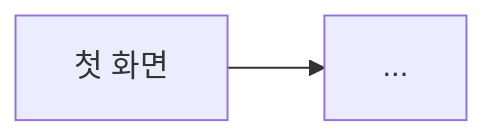

# <앱 이름> 기획서

<!-- 견본: .claude/skills/build-app/templates/requirements.md — 사장이 읽는 문서. 짧고 쉬운 말로. "## " 절 이름과 "- " 줄 모양은 graph.sh가 읽으니 바꾸지 않는다 -->

## 출시 안내문
<!-- 다 만들었다고 치고 사용자에게 보내는 안내 3문장(Working Backwards). 무엇이 좋아지는지가 보여야 한다. 마지막 QA 때 "안내문에 없는 걸 만들었나"를 본다 -->
- <예: 이제 엑셀 양식을 버튼 하나로 바꿀 수 있습니다.>
- <예: 파일을 올리면 1분 안에 완성본이 나옵니다.>
- <예: 틀린 칸이 있으면 빨갛게 표시해 바로 고칠 수 있습니다.>

## 예상 질문
- <예: 내 파일은 어디에 저장되나요? → 저장하지 않고 바로 지웁니다.>
- <질문 → 답>
- <질문 → 답>

## 성공 기준
<!-- 이 앱이 잘 됐다는 증거. 측정하거나 눈으로 확인할 수 있게. 1~3개. 6단계 QA 보고에서 ✓/✗로 확인한다 -->
- <예: 엑셀 정리 시간이 30분 → 1분 이하>
- <예: 변환 결과에서 틀린 칸 0개 (견본 3쌍 기준)>

## 빈칸 점검표
<!-- 칸마다 "정함: <답>" / "나중: <이유>" / "해당 없음". "묻기"가 하나라도 남으면 graph.sh가 req를 통과시키지 않는다 -->
- 사용자·상황: 정함: <누가, 어디서(폰/PC), 얼마나 자주>
- 성공 기준: 정함: 위 절
- 꼭 되어야 할 기능: 정함: 아래 절
- 첫 버전 흐름: 정함: <1차 기능만으로 처음부터 끝까지 한 번 도는 흐름, 아래 화면 흐름도>
- 하지 않을 것: 정함: 아래 절
- 데이터: <무엇을 저장, 얼마나 보관, 지우기>
- 민감 정보: <이름·연락처·돈·건강 등 있는지, 있으면 어떻게 다루는지>
- 되돌리기 어려운 동작: <돈 결제·메시지 발송·삭제가 있는지 → 있으면 확인 절차를 기능으로>
- 로그인·권한: <누가 무엇을 볼 수 있는지>
- 외부 연결: <다른 서비스·API·파일>
- 예외: <빈 값, 인터넷 끊김, 잘못된 파일>
- 예산: <사장이 쓸 시간·돈의 한도, 첫 버전 범위>
- 견본 파일: <변환 전/후 파일이 있는지 (사람이 손으로 하던 일을 대신하는 앱만)>
- 화면 초안: <docs/wireframe/ 캡처 (화면이 있는 앱만, 없으면 해당 없음)>

## 꼭 되어야 할 기능
<!-- 기능 줄: "- F<번호> [1차|나중·꼭|많을수록|놀람] <기능>"
     1차 = 첫 버전에 넣음(1차만으로 처음부터 끝까지 한 번 돌아야 함), 나중 = 테스트·구현에서 빠짐
     꼭 = 없으면 화남, 많을수록 = 좋을수록 만족, 놀람 = 있으면 기쁨(대개 나중)
     1차 기능마다 수용 기준 1~3줄: "F<기능>-<번호> <언제/조건>이면 앱은 <보이는 결과>를 한다 — 예: <실제 값 예시>" (예외 하나 이상) -->
- F1 [1차·꼭] <기능>
  - F1-1 <언제/조건>이면 앱은 <보이는 결과>를 한다 — 예: <입력 값 → 결과 값>
  - F1-2 <예외 상황>이면 앱은 <안내·막기>를 한다 — 예: <빈 값 → "이름을 넣어 주세요">
- F2 [나중·놀람] <나중에 넣을 기능>

## 외부 자료·데이터
<!-- 법무팀(lg)이 항목마다 GREEN/YELLOW/RED로 판정한다. 남이 만든 것을 쓰면 모두 적는다:
     웹사이트에서 모으는 자료(크롤링), 외부 API, 이미지·글·음악·영상·폰트·아이콘, 데이터셋.
     "- <이름> — 출처: <주소> — 쓰는 방식: <내부 참고|화면 표시|AI 학습|RAG|재배포|상업 이용 …>"
     하나도 없으면 "- 없음" (오픈소스 라이브러리 라이선스는 출시 전에 법무팀이 따로 본다) -->
- 없음

## 개인정보
<!-- 모으는 개인정보와 이유. 로그인(이메일·비밀번호)도 해당. 없으면 "- 없음".
     외부 자료와 개인정보가 둘 다 "- 없음"이면 법무 검토(lg·ok-lg)를 건너뛴다 -->
- 없음

## 하지 않을 것
- <첫 버전에서 일부러 빼는 것과 이유>

## 화면 흐름

