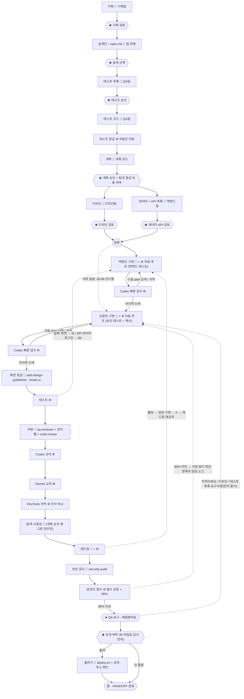

# ai-workflow

사용자는 **사장**, Claude의 팀들(기획·디자인·프론트엔드·백엔드·QA)은 **직원**입니다.
사장은 정하고 검토만 하고(모든 팀의 결과물은 사장 검토를 받음), 나머지(계획, 구현, 테스트, 리뷰, 문서, 커밋)는
Claude Code가 혼자 돌려서 앱을 만드는 작업장 견본입니다.
근거: 이석균 선배님 특강 (정리 문서는 비공개 저장소에 따로 보관)

> 이 README는 Claude Code가 읽고 개발을 시작하는 설명서입니다.

## 들어 있는 것
규칙을 "부탁"이 아니라 **구조**로 지키게 나눠 두었습니다. CLAUDE.md는 공식 권장(200줄 이하)보다 짧게, 매번 알아야 하는 사실만 담습니다.

| 폴더 | 무엇 | 왜 여기에 |
|---|---|---|
| `CLAUDE.md` | 프로젝트 소개, 자주 쓰는 명령, 역할, 팀별 기술 | 매 세션 항상 읽힘 → 짧을수록 잘 지킴 |
| `.claude/rules/` | 보안·백엔드 설계(SOLID)·화면(웹+안드로이드·iOS)·테스트 규칙 | 파일 위에 경로를 적어 그 경로를 열 때만 불러짐 |
| `.claude/skills/` | `/build-app`(앱 흐름 그래프 `graph.md` + 순서를 지키는 `graph.sh` + 단계별 스킬 표 + 자동 구현 루프), `/handoff`(HANDOFF → 커밋 → 푸시), `/weekly-review`(반복된 실수 → 규칙 후보 최대 3개) | 평소엔 설명 한 줄만, 쓸 때만 본문을 읽음 |
| `.claude/hooks/` | 실패 상태 커밋·강제 푸시·비밀값 커밋 차단, 승인된 테스트 잠금(사장만 잠금, 수정 시 확인 창, 어떤 방법으로 바꿔도 커밋 직전·응답 끝에 해시로 잡음), 민감한 파일 수정 시 레드팀 다시 돌리기 표시, 세션 시작 점검·주간 회고 알림. 시험: `bash .claude/hooks/test-hooks.sh --settings` | Claude가 뭘 판단하든 동작 자체를 막음 |
| `.claude/agents/` | 개발팀 `backend-dev`·`frontend-dev`(실제로 코드를 짬, 자기 팀 파일만 — `team-files.sh` 훅, 조직은 [docs/org.md](docs/org.md)), QA팀 `test-runner`·`qa-reviewer`, 보안 검증팀 `red-team`, 법무팀 `legal`(외부 자료·개인정보·라이선스 GREEN/YELLOW/RED, `docs/legal.md`만) (qa-reviewer·red-team은 자주 나오는 문제를 `.claude/agent-memory/`에 쌓음 — 공개 저장소라 일반 패턴만, 앱별 증거·키는 안 적음) | 자기 컨텍스트에서 일하고 요약만 돌려줘 메인 대화가 가벼움 |

- `/build-app` 순서는 그래프(`graph.md`)가 정하고 자동으로 흐름: 질문 → 설계안 3개 → 테스트 목록 승인(첫 잠금 자동) → 계획 → 백엔드 → 프론트(Stop 훅 자동 루프, 일지 `progress.md`, 15회·같은 실패 3회면 멈춤) → 별도 리뷰 + **교차 리뷰**(Codex·Gemini, 필수) → 레드팀 → 완성도 90% → 확인("해결됐어요 / 아직이에요")·올리기. 사장은 ★에서 보기만 누름
- 예약 작업은 쓰지 않습니다. 세션을 열 때 진행 중인 앱 테스트를 한 번 돌리고, 7일이 지났으면 주간 회고를 한 번 묻습니다.
- 플러그인: superpowers, modern-web-guidance, context7, chrome-devtools-mcp, **ECC**(affaan-m/ECC — 시장조사·Spring·테스트 가이드, 빌드 에러 해결·언어별 리뷰 에이전트만 골라 씀, ECC 훅은 꺼 둠)
- `HANDOFF.md`: 어느 컴퓨터에서든 여기서 이어서 시작
- `setup/new-project/`: 어디서든 "새 프로젝트 만들어 줘"로 이 견본을 꺼내 쓰는 개인 스킬

## 새 컴퓨터에서 한 번에 세팅하기
새 컴퓨터의 Claude Code에 이렇게만 말하면 됩니다.
```
junyeop3407/ai-workflow README 보고 이 컴퓨터 세팅해 줘
```

### Claude가 따라 할 순서 (새 컴퓨터 세팅)
> 이 저장소는 공개 저장소다. README는 `gh api repos/junyeop3407/ai-workflow/readme -H "Accept: application/vnd.github.raw"`로 읽는다.
> 이미 된 단계는 확인만 하고 넘어간다. 사용자는 개발 초보: 사용자가 직접 해야 하는 것은 `!`로 시작하는 짧은 한 줄로 주고, 맨 앞에 띄어쓰기가 없어야 실행된다고 알려 준다.

1. **git**: `git --version`. 없으면 Windows `winget install --id Git.Git -e`, Mac `xcode-select --install`. (Windows는 Git Bash가 함께 깔리고 훅이 이걸로 돈다)
2. **GitHub CLI**: `gh --version`. 없으면 Windows `winget install --id GitHub.cli -e`, Mac `brew install gh`.
   **Windows에서는 설치 직후 `gh`가 PATH에 없는 일이 흔하다.** 이후 모든 bash 명령에서 gh를 이렇게 정해 쓴다:
   `GH=gh; command -v gh >/dev/null || GH="/c/Program Files/GitHub CLI/gh.exe"` (그다음 `"$GH" ...`)
3. **GitHub 로그인**: `"$GH" auth status`. 안 돼 있으면 사용자에게 부탁: `! gh auth login --web` (gh가 PATH에 없으면 `! "/c/Program Files/GitHub CLI/gh.exe" auth login --web`). 끝나면 `"$GH" auth setup-git`.
4. **git 이름·이메일**: `git config --global user.name` / `user.email`이 비어 있으면 사용자에게 묻고 `--global`로 설정.
5. **`/new-project` 스킬 설치** (Git Bash 또는 Mac 터미널, 2번의 `GH`를 정한 뒤):
   `mkdir -p ~/.claude/skills/new-project && "$GH" api repos/junyeop3407/ai-workflow/contents/setup/new-project/SKILL.md -H "Accept: application/vnd.github.raw" > ~/.claude/skills/new-project/SKILL.md`
   → 파일 첫 줄이 `---`이고 `name: new-project`가 있는지 확인.
6. **선택 (사용자에게 하나씩 묻기, 추천 붙여서)**:
   - 팀 기본 기술 도구(Java JDK, Node.js, Playwright 브라우저): 첫 앱을 만들 때 필요한 것만 깔아도 됨(추천: 지금은 건너뜀). 설치 명령은 HANDOFF.md "처음 쓰는 컴퓨터 준비" 6번.
   - 교차 리뷰 도구(아래 "교차 리뷰" 절): Node.js + Codex CLI + Gemini CLI. **교차 리뷰는 필수**라 첫 앱의 4단계 전에는 깔아야 함(추천: 지금 설치). Codex는 ChatGPT 계정 로그인, Gemini는 Google AI Studio 무료 API 키 필요.
7. **이어서 하던 프로젝트가 있으면**: 사용자에게 저장소 이름을 묻고 `"$GH" repo clone junyeop3407/<이름>` → 그 폴더에서 `HANDOFF.md 읽고 이어서 해 줘`.
8. **알려 주기** (짧게): 된 것 / 건너뛴 것, 그리고 사용법 — 아무 폴더에서 `/new-project 만들고 싶은 것`. `/new-project`가 목록에 안 보이면 Claude Code를 한 번 껐다 켠다.

## 새 프로젝트 시작하기 (명령을 외울 필요 없음)
아무 폴더에서나 Claude Code를 열고 이렇게 말하면 됩니다.
```
/new-project 만들고 싶은 것
```
Claude가 이름을 정하고(추천해 줌), 이 견본으로 공개 저장소를 만들어 내려받습니다. 앱을 다 만들고 나면 공개로 둘지 비공개로 바꿀지 물어봅니다.
그다음 만들어진 폴더를 Claude Code로 열고 `/build-app 만들고 싶은 것`.

> 직접 하고 싶으면: `gh repo create <새이름> --public --template junyeop3407/ai-workflow --clone`

### 다른 컴퓨터에서 `/new-project`를 쓰려면 (한 번만)
Git Bash(또는 Mac 터미널)에서, GitHub 로그인(`gh auth login --web`) 뒤:
```
GH=gh; command -v gh >/dev/null || GH="/c/Program Files/GitHub CLI/gh.exe"; mkdir -p ~/.claude/skills/new-project && "$GH" api repos/junyeop3407/ai-workflow/contents/setup/new-project/SKILL.md -H "Accept: application/vnd.github.raw" > ~/.claude/skills/new-project/SKILL.md
```

## 교차 리뷰 (필수 — Codex + Gemini)
만든 AI(Claude)와 다른 AI 두 곳에 검수받습니다. 둘 다 건너뛰지 않습니다(없으면 Claude가 설치·로그인을 부탁함).
> ⚠ **앱 코드가 OpenAI(Codex)와 Google(Gemini) 서비스로 보내집니다.** `.env`·키 파일·`samples/`(실제 업무 파일)는 스크립트가 빼고 보냅니다.
- **Codex 설치**: Node.js → `npm install -g @openai/codex` → `codex login`(브라우저에서 ChatGPT 계정 로그인). 검수는 읽기 전용 모드(`-s read-only`)로 빈 임시 폴더에서 돌아 파일을 고치지 못합니다.
- **Gemini 설치**: Node.js `winget install --id OpenJS.NodeJS.LTS -e` → `npm install -g @google/gemini-cli` → https://aistudio.google.com/apikey 에서 무료 API 키를 만들고 PowerShell에서 `[Environment]::SetEnvironmentVariable("GEMINI_API_KEY", "<키>", "User")` 실행 (Google 계정 로그인 방식은 개인 무료 사용이 막혀 안 됨. 무료 키는 flash 모델만 쓸 수 있어 스크립트가 flash를 기본으로 씀)
- 실행: `bash .claude/skills/build-app/cross-review.sh apps/<앱> <기준> [codex|gemini]` → Codex `docs/review_codex.md`, Gemini `docs/review_result.md`
- 언제: 4단계에서 계획의 단계 하나가 통과할 때마다 Codex로 그 단계만 빠르게, 5단계에서 qa-reviewer(Claude) → Codex → Gemini 순서로 전체. 각 1라운드.
- Claude가 각 지적이 맞는지 코드로 확인해 맞는 것만 고칩니다(회귀 테스트 먼저). 두 곳 이상이 같은 문제를 지적하면 먼저 고치고, 심각도 "높음"인데 애매하면 사장에게 묻습니다. 반영 안 한 지적은 결과 파일 맨 아래 "Claude 판단"에 이유를 남깁니다.
- 6단계 QA 보고에 "Codex: 반영 N / 미반영 N(이유) · Gemini: 반영 N / 미반영 N(이유) · 사장 확인 필요"로 정리됩니다.

## 사장이 하는 일 (모든 팀의 결과물을 검토)
| 언제 | 팀 | 할 일 |
|---|---|---|
| 1단계 | 기획팀 | 질문에 답하기(보기 중 고르기) → 기획서 검토 |
| 2단계 | 전체 | 설계안 3개(+디자인 방향) 중 고르기 |
| 3단계 | QA팀 | "뭐가 되면 끝인가" 테스트 목록 승인 |
| 4단계 시작 | 디자인팀 | 디자인 규칙과 시안 화면 캡처 검토 |
| 4단계 시작 | 개발팀 백엔드 | 저장할 데이터와 기능 목록 검토 (서버가 있는 앱만) |
| 6단계 | 개발팀·QA팀·보안 검증팀 | QA 보고(완성도 점수, 테스트 결과, 리뷰에서 고친 것, 사장 확인 필요) 보고 완성된 앱을 써 본 뒤 OK → 저장소 공개 여부·올릴지 고르기(올리기는 Claude가 실행) |

검토는 "OK" 또는 고칠 점을 말하면 됩니다(보기 클릭). 고칠 점을 말하면 고쳐서 다시 검토를 요청합니다. 사장이 직접 치는 명령은 없습니다(안전장치가 외부 공개를 막거나, 승인된 테스트를 다시 잠글 때만 한 줄을 부탁).

## 이 작업장이 따르는 AI 자동화 10단계
참고 자료: [처음 만나는 AI 자동화 10단계](https://claude.ai/artifact/PhedbNbJD5LvCJg47BqEYg) — 이 저장소는 아래 순서대로 쌓여 있다.

| 단계 | 이 작업장에서 하는 것 | 어디에 | 확인 방법 | 적용 정도 |
|---|---|---|---|---|
| 1 프롬프트(부탁 템플릿) | 사장은 짧게 말하고, Claude가 ★ 질문(보기 + 추천)으로 요구사항을 끌어냄. 새 세션 첫 마디는 HANDOFF에 | [HANDOFF.md](HANDOFF.md), [build-app SKILL.md](.claude/skills/build-app/SKILL.md) | HANDOFF.md "새 세션 시작 방법" | 부분 — 따로 된 부탁 템플릿 파일은 없음(★ 질문과 HANDOFF 첫 마디로 대신) |
| 2 컨텍스트(CLAUDE.md) | 매번 알아야 하는 사실만 짧게, 주제별 규칙은 경로를 열 때만 | [CLAUDE.md](CLAUDE.md), [.claude/rules/](.claude/rules/) | `wc -l CLAUDE.md` (200줄 이하) | 전부 |
| 3 스킬(SKILL.md) | 앱 한 바퀴·마무리·주간 회고·새 프로젝트 절차 | [build-app](.claude/skills/build-app/SKILL.md), [handoff](.claude/skills/handoff/SKILL.md), [weekly-review](.claude/skills/weekly-review/SKILL.md), [new-project](setup/new-project/SKILL.md) | `/build-app`, `/handoff` | 전부 |
| 4 서브에이전트(agents) | 테스트 실행·분리 리뷰·레드팀을 따로 돌려 요약만 받음. 디자인 ∥ 데이터 설계는 동시에 | [.claude/agents/](.claude/agents/) | 에이전트 파일 3개 | 전부 |
| 5 하네스(훅·권한) | 실패 상태 커밋·강제 푸시·비밀값·승인 테스트 변경·state.json 직접 편집을 시스템으로 막음 | [.claude/hooks/](.claude/hooks/), [settings.json](.claude/settings.json) | `bash .claude/hooks/test-hooks.sh --settings` | 전부 |
| 6 루프(자동 루프·progress.md·횟수 제한) | 구현은 Stop 훅이 통과 검사를 돌려 통과까지 혼자 돎. 15회·같은 실패 3연속·점수 5바퀴·2바퀴 정체면 보고 | [graph-stop.sh](.claude/hooks/graph-stop.sh), [graph.sh](.claude/skills/build-app/graph.sh) | `bash .claude/hooks/test-graph.sh` | 전부 |
| 7 툴링(MCP·팀·워크트리) | MCP(context7 문서, chrome-devtools 점검), 외부 AI 교차 검수(Codex·Gemini), 팀 단위 역할. 리뷰 시점: 기능 하나 완료 → `/codex:review`, 배포 전(완성도 90% 넘김) → `/codex:adversarial-review` + 레드팀 + `agy -p` 검토. 리뷰 게이트는 끔 | [settings.json](.claude/settings.json), [cross-review.sh](.claude/skills/build-app/cross-review.sh), [ai-team.md](.claude/rules/ai-team.md) | `claude mcp list` | 부분 — 워크트리는 안 씀(같은 폴더에서 bb → bf 순서로 동시 수정을 피함), 에이전트 팀 대신 서브에이전트 |
| 8 그래프(graph.md·state.json·graph.sh) | 노드·실패 엣지·멈추는 곳 다섯, 문제는 담당 노드로만 되돌림, 상태는 앱마다 state.json | [graph.md](.claude/skills/build-app/graph.md), [graph.sh](.claude/skills/build-app/graph.sh) | `bash .claude/skills/build-app/graph.sh lint` | 전부 |
| 9 루프크래프트(예약 대신 세션 시작 점검) | 세션을 열 때 진행 중 앱 상태·테스트 점검, 7일마다 주간 회고 묻기 | [session-start.sh](.claude/hooks/session-start.sh) | [docs/last-weekly-review.txt](docs/last-weekly-review.txt) | 부분 — 사장 컴퓨터를 켜 두지 않아서 예약 작업 대신 일부러 세션 시작 때로 바꿈 |
| 10 자기 개선(에이전트 메모리·/weekly-review) | 리뷰·레드팀 에이전트가 자주 나오는 문제를 메모리에, 주간 회고가 반복된 실수 → 규칙 후보 최대 3개 | [qa-reviewer.md](.claude/agents/qa-reviewer.md), [red-team.md](.claude/agents/red-team.md), [weekly-review](.claude/skills/weekly-review/SKILL.md) | `/weekly-review` | 부분 — 메모리 폴더(`.claude/agent-memory/`)는 첫 리뷰 때 생겨 아직 없음, 규칙은 사장이 고른 것만 반영 |

### 그래프 흐름도 (graph.md와 같음)


### 앱 하나가 만들어지는 순서 (5줄)
1. 사장이 "○○ 앱 만들어 줘" → 기획·설계·테스트 목록을 ★ 질문(보기 클릭)으로 정하고, 테스트는 자동으로 잠긴다.
2. 계획 승인 때 탐색 점검 비용까지 한 번에 묻고, 디자인과 데이터·API 설계를 동시에 만들어 ★ 검토를 받는다.
3. 백엔드 → 프론트 순서로 Stop 훅 자동 루프가 테스트를 통과할 때까지 혼자 고치고, 단계마다 Codex가 빠르게 검수한다.
4. 화면 점검·리뷰·Codex·Gemini·DevTools·레드팀·보안 감사를 거쳐 완성도 90%(필수 관문 포함)를 넘을 때까지 담당 노드로만 되돌려 고친다.
5. ★ QA 보고에서 사장이 써 보고 "해결됐어요"를 누르면, 공개 여부를 고르고(올리기는 Claude가 실행) 끝난다.
